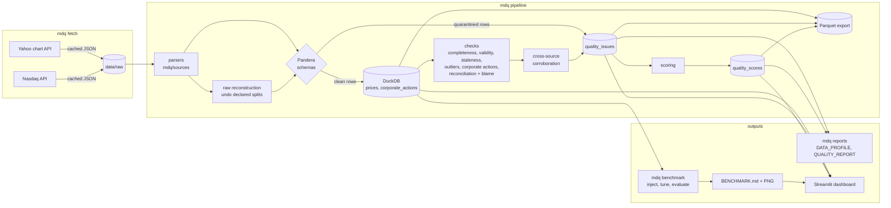
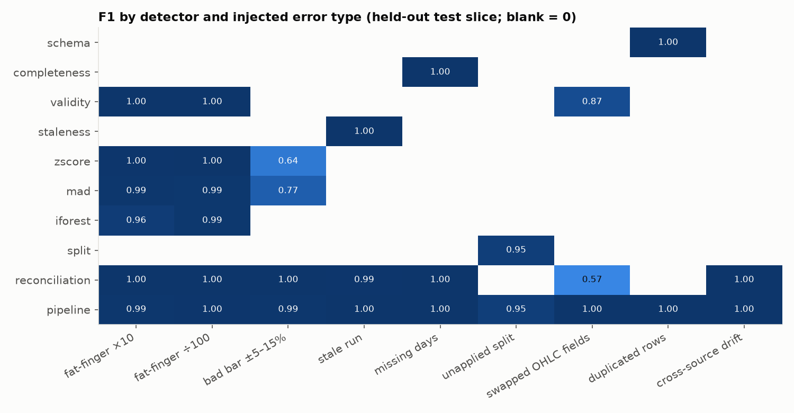

# market-data-quality

[](https://github.com/saivedulapurapu/market-data-quality/actions/workflows/ci.yml)

A data-quality monitoring pipeline for daily equity prices. It ingests the same securities from
**two independent free sources**, detects and scores data-quality issues, reconciles the
sources against each other, verifies corporate-action adjustments, and **measures its own
detection accuracy** with an injected-error benchmark.

Every number in this README is produced by code in this repository. The sources are
[`reports/BENCHMARK.md`](reports/BENCHMARK.md), [`reports/QUALITY_REPORT.md`](reports/QUALITY_REPORT.md)
and [`reports/DATA_PROFILE.md`](reports/DATA_PROFILE.md), all generated by `python -m mdq ...`.

## Problem

Vendor price data fails in quiet ways: a fat-fingered print, a feed that stops updating and
repeats yesterday's bar, a split that was never back-adjusted, two vendors that disagree
about history after a spin-off. A pipeline that consumes the data needs to:

1. find these errors;
2. say how sure it is and which source is likely wrong;
3. show, with numbers, how often it catches each kind of error and how often it raises
   false alarms.

## Sources

| Source | Used for | Notes |
|---|---|---|
| **Yahoo Finance chart API** (`query1.finance.yahoo.com/v8/finance/chart`) | Source A: OHLCV, split and dividend events, dividend-adjusted close | Unofficial endpoint. OHLC split-adjusted. |
| **Nasdaq.com historical API** (`api.nasdaq.com/api/quote/{T}/historical`) | Source B: OHLCV | Unofficial endpoint. Split-adjusted, no events. Returns no rows for short windows, so the full 5-year window is requested in one call. |

Stooq was evaluated first and rejected: its CSV endpoint now serves a JavaScript
proof-of-work bot challenge, and this project does not work around bot protection.

**Terms and data handling.** Data is fetched locally for personal research only and is
**not redistributed**. `data/raw/` and `data/processed/` are gitignored, and no vendor data,
not even a trimmed slice, is committed. Every test fixture is synthetic
([`mdq/synthetic.py`](mdq/synthetic.py)). Requests send an honest User-Agent
(`market-data-quality/1.0 (personal research)`), go one at a time with a 1.5 s pause, and are
cached so each URL is fetched once. A non-200 or non-JSON response stops the run rather than
being retried. Credit to Yahoo Finance and Nasdaq.com for the data.

**Universe:** 50 large-cap US stocks (25 Nasdaq-listed, 25 NYSE-listed) plus SPY and QQQ,
2021-11-08 to 2026-11-05: 1,254 NYSE sessions and 65,208 rows per source.

## Architecture



**Stack:**

- **Storage:** DuckDB with plain SQL DDL (no ORM), plus Parquet export.
- **Validation:** Pandera for every DataFrame entering the store.
- **Analysis:** pandas, numpy and scikit-learn (Isolation Forest).
- **Calendar:** `pandas_market_calendars` (XNYS).
- **Dashboard:** Streamlit and Plotly.
- **Benchmark charts:** matplotlib.
- **Tests:** pytest.

The data model and its ER diagram are in [`docs/SCHEMA.md`](docs/SCHEMA.md).

### Data lineage

1. **Fetch.** `data/raw/<source>/<ticker>.json` holds the untouched API payloads.
2. **Parse.** Each source has its own parser. Dates are converted to the exchange date, and
   rows are clipped to complete sessions in the window: a payload fetched during market hours
   carries a partial bar for today, and that bar is dropped.
3. **Reconstruct raw.** An as-traded series (`adjustment='raw'`) is rebuilt by undoing the
   declared splits.
4. **Validate.** Pandera checks every frame. Rows that fail structurally (null key, duplicate
   key, bad category or type) are quarantined and logged as `schema_*` issues.
5. **Load.** Rows go into the DuckDB tables `securities`, `sources`, `prices` and
   `corporate_actions`.
6. **Check.** The checks run on the split-adjusted series of each source.
7. **Reconcile.** Reconciliation compares the two sources and attributes blame.
8. **Corroborate.** Flags that fire on both sources are downgraded to `info`.
9. **Store issues.** Results are written to `quality_issues`, with value, expected value and
   JSON evidence.
10. **Score.** Scores go to `quality_scores`; the `dataset_scores` view averages them.
11. **Export.** Every table is exported to `data/processed/parquet/*.parquet`.

## Checks

Full rationale and parameters are in [`docs/CHECKS.md`](docs/CHECKS.md). Thresholds were tuned
on a validation slice; see [Benchmark](#benchmark-results).

| Family | Check | Rule (tuned parameter) |
|---|---|---|
| Schema | `schema_duplicate_key`, `schema_null_key`, … | Pandera validation; rows quarantined |
| Completeness | `missing_day`, `non_trading_day`, `missing_field` | vs NYSE calendar, within the union of both sources' coverage |
| Validity | `ohlc_inconsistent`, `non_positive_price`, `negative_volume`, `zero_volume` | low ≤ open, close ≤ high; prices > 0; volume ≥ 0 |
| Staleness | `stale_close` | ≥ **4** identical consecutive closes |
| Outliers | `outlier_zscore`, `outlier_mad`, `outlier_iforest` | Spike score (big move in, opposite big move out) on 63-day trailing mean/std (**z > 5**) or median/MAD (**> 5**); Isolation Forest on returns, volume and range (**score > 0.75**). Only MAD is scored. |
| Corporate actions | `unadjusted_split`, `suspected_unadjusted_split` | Jump ≈ −log(ratio) on the ex-date **and** a persistent level shift (tolerance **0.10** log) |
| Corporate actions | `dividend_adjustment_mismatch`, `unexplained_adjustment` | Yahoo adj factor step vs 1 − D/prev close (tolerance 5e-4) |
| Reconciliation | `recon_close_mismatch`, `recon_missing_in_source` | \|Δclose\| > **2 bps** + half a cent. Blame from self-consistency and bar ranges, with a persistence rule for level differences. |
| Scoring | `quality_scores` | 100 − Σ per-check max severity weight (critical 60, error 30, warning 10, info 0) |

**Cross-source corroboration.** A stale or outlier flag that fires identically on both
independent sources, with no price disagreement, is downgraded to `info`: it is kept, but
not scored. It is very likely a genuine market move, not a vendor error.

## Benchmark results

How the benchmark is set up:

- **Data.** Real data for the 40 securities that passed a fixed-parameter screening run.
- **Split.** Securities are split 20 / 20 into validation and test (seed 42). Thresholds are
  tuned on validation; every number below comes from the **held-out test half**: 20
  securities, 25,080 rows per source.
- **Injection.** Each error type is injected in its own scenario with a fixed seed, into one
  randomly chosen source per event.

Full method and matrix: [`reports/BENCHMARK.md`](reports/BENCHMARK.md).

| Error type | Labels | Designed detector | Precision | Recall | F1 | Pipeline alerts P / R / F1 |
|---|---|---|---|---|---|---|
| Fat-finger ×10 | 100 | MAD | 0.98 | 1.00 | 0.99 | 0.98 / 1.00 / 0.99 |
| Fat-finger ÷100 | 100 | MAD | 0.97 | 1.00 | 0.99 | 0.99 / 1.00 / 1.00 |
| Bad bar ±5–15% | 100 | MAD | 0.97 | 0.64 | 0.77 | 0.98 / 1.00 / 0.99 |
| Stale run (3–6 days) | 454 | staleness | 1.00 | 1.00 | 1.00 | 1.00 / 1.00 / 1.00 |
| Missing days | 200 | completeness | 1.00 | 1.00 | 1.00 | 1.00 / 1.00 / 1.00 |
| Unapplied split | 20 | split | 1.00 | 0.90 | 0.95 | 1.00 / 0.90 / 0.95 |
| Swapped OHLC fields | 100 | validity | 1.00 | 0.77 | 0.87 | 1.00 / 1.00 / 1.00 |
| Duplicated rows | 100 | schema | 1.00 | 1.00 | 1.00 | 1.00 / 1.00 / 1.00 |
| Cross-source drift (≥10 bps) | 495 | reconciliation | 1.00 | 1.00 | 1.00 | 1.00 / 1.00 / 1.00 |

**Outlier detectors on the same test scenarios (P / R / F1):**

| | Fat-finger ×10 | Fat-finger ÷100 | Bad bar ±5–15% |
|---|---|---|---|
| z-score | 0.99 / 1.00 / 1.00 | 1.00 / 1.00 / 1.00 | 1.00 / 0.47 / 0.64 |
| **MAD** | 0.98 / 1.00 / 0.99 | 0.97 / 1.00 / 0.99 | 0.97 / **0.64** / **0.77** |
| Isolation Forest | 0.99 / 0.93 / 0.96 | 0.98 / 0.99 / 0.99 | 0.00 / 0.00 / 0.00 |



**Takeaways**

- **Gross errors are easy.** All three outlier detectors catch ×10 and ÷100 spikes at an F1
  of 0.96 or better.
- **Moderate errors separate them.** On ±5–15% bad bars, MAD recalls 64% against z-score's
  47%. A spike inflates the trailing standard deviation, masking nearby errors; the MAD
  barely moves. A unit test reproduces that masking directly.
- **Isolation Forest finds none of the moderate bad bars.** It has no notion of a
  move-and-reversal, and single-day bad bars of this size don't stand out in its feature
  space.
- **The second source matters most.** Reconciliation alone recalls 100% of ±5–15% bad bars,
  where the best single-source detector manages 64%. It also lifts end-to-end recall on
  swapped OHLC fields from 0.77 to 1.00: an open↔close swap passes every single-source check
  but changes the close.
- **Blame is reliable for point errors, not for smooth ones.** It names the right source for
  100% of injected ×10 and ÷100 spikes and 95% of bad bars, and is wrong on none of them.
  It is unreliable for stale runs and drift, where there is no majority vote between two
  smooth series.
- **Both missed splits coincide with real large moves.** One ex-date fell on a real −20% day;
  in the other, a real rally of about +18% inside the 5-session persistence window broke the
  level-shift test.

## Real issues found

From [`reports/QUALITY_REPORT.md`](reports/QUALITY_REPORT.md), on 130,416 split-adjusted rows
(65,208 per source):

| Check | Severity | Count | Securities |
|---|---|---|---|
| `recon_close_mismatch` | warning | 1,044 | 3 |
| `ohlc_inconsistent` | error | 10 | 10 |
| `missing_field` | error | 1 | 1 |
| `outlier_iforest` | warning | 2 | 2 |
| `outlier_iforest` / `outlier_mad` | info (corroborated) | 22 / 10 | 11 / 5 |

- **Overall:** dataset score 99.835 / 100; 98.38% of security-days score a perfect 100.
- **Coverage:** 100% of expected sessions for both sources.
- **Agreement:** 98.39% of security-days agree within 1 bp.
- **Corporate actions:** 0 dividend-adjustment mismatches across 818 dividends; all 10
  splits verified in both sources.

Examples:

1. **CMCSA: the vendors disagree on a spin-off adjustment.** For all 1,042 sessions before
   2026-01-05 the two sources differ by a constant −16.2 bps (std 0.08 bps). Yahoo models the
   Versant Media spin-off as a 1067:1000 "split"; the Nasdaq factor implied by the data is
   about 1.06527. From the ex-date on, the sources agree exactly. The persistence rule marks
   all 1,042 days as `undetermined`: neither print is wrong, but the two histories rest on
   different bases.
2. **2023-06-05: Nasdaq opens outside the bar's own range for 10 NYSE stocks** (BA, BAC, CAT,
   CVX, JNJ, JPM, NKE, WFC, WMT, XOM). For example, BA had open 213.28 against a high of
   210.44. These are 10 of the universe's 25 NYSE names and none of its Nasdaq-listed names,
   and Yahoo's bars that day are consistent. This is the worst day in the dataset score
   (94.04).
3. **JNJ 2023-08-23: an 81 bps close disagreement, blamed on Nasdaq.** Nasdaq's close of
   163.20 lies outside Yahoo's [163.47, 166.50] range, and its whole bar differs (high 170.18
   vs 166.50). This was during the Kenvue exchange offer.
4. **SPY 2026-04-20: a Nasdaq placeholder bar.** Open = high = low = close = 710.14 with no
   volume (`missing_field`), 20 bps away from Yahoo's 708.72.
5. **Corroborated outliers are not errors.** For example, CRM fell about 20% on 2024-05-30 and
   partly rebounded the next day. Both sources printed the same close, so the flag is `info`.

## Limitations

- **Unofficial endpoints.** Both APIs can change or block without notice. A rejection stops
  the fetch with an explicit error; the code does not retry around it.
- **Two sources.** Blame relies on self-consistency and bar ranges, not a majority vote. It
  is unreliable for stale runs and drift, and both vendors may share an upstream error,
  which corroboration would then hide.
- **Both vendors split-adjust.** Real unadjusted splits are therefore unlikely in this data.
  The split detector is validated on injected unapplied splits, and on real data it verifies
  that adjusted series show no jump at all 10 ex-dates.
- **Benchmark scope.**
  - Each error type is injected in isolation; a mixed case is not measured.
  - The dividend check is not benchmarked.
  - Drift below 10 bps is unlabelled by design.
  - The slice was screened at 10 bps and the reconciliation tolerance then tuned down to
    2 bps. On the full data, 2 bps and 10 bps give the same mismatch count.
- **Volume is not reconciled.** The median Nasdaq/Yahoo volume ratio is 1.0000, with a 1st
  percentile of 0.937; a volume check would need its own tolerance.
- **Spikes at the edges are not scored.** The spike score needs the next day's return, so
  the newest bar is re-evaluated on the following run.
- **Scale.** Single-process and in-memory, which is fine for about 130k rows per adjustment
  basis. Larger universes would push more of the checks into DuckDB SQL.

## How to run

Windows (PowerShell):

```powershell
.\run.ps1 setup      # create .venv (Python 3.13) and install pinned requirements
.\run.ps1 fetch      # download raw payloads (cached; ~2.5 min the first time)
.\run.ps1 pipeline   # load, validate, check, score, export Parquet  (~30 s)
.\run.ps1 benchmark  # injected-error benchmark -> reports/BENCHMARK.md (~6 min)
.\run.ps1 reports    # DATA_PROFILE.md, QUALITY_REPORT.md
.\run.ps1 dashboard  # Streamlit app
.\run.ps1 test       # pytest (no network)
```

macOS / Linux: `make setup fetch pipeline benchmark reports dashboard test`. Or directly:
`python -m mdq {fetch,pipeline,benchmark,reports,all}`, and
`streamlit run app/streamlit_app.py`.

**Dashboard pages:**

- **Overview:** dataset score over time and per-security scores.
- **Issues:** counts by type and severity.
- **Ticker:** per-ticker price chart by source, with flagged points, for the split-adjusted
  or raw series.
- **Sources:** source-vs-source difference chart.
- **Corporate actions:** split verification and the event list.
- **Benchmark:** results heatmap and outlier comparison.

## Tests

`pytest` runs 86 tests with 95% line coverage. CI (GitHub Actions) runs them with coverage
on every push. Tests never touch the network, and all fixtures are synthetic series with
known, planted defects.

- **Every check** is tested on hand-built defects, including the z-score vs MAD masking case.
- **Pandera schemas:** quarantine and logging.
- **Corporate actions:** split detection (declared, undeclared, reverse), raw reconstruction
  round trip, dividend factor verification.
- **Reconciliation:** blame, drift and persistence.
- **Scoring:** weights and deduplication.
- **Benchmark:** injection reproducibility for every error type (same seed gives the same
  output; a different seed gives different output), label semantics, and an end-to-end
  benchmark plus report on synthetic data.
- **Ingest:** from synthetic cached payloads.
- **Dashboard:** data functions, and a headless Streamlit render of every page.

## Repository layout

```
mdq/            sources/ (fetch + parse), schemas.py, store.py, ingest.py, adjust.py,
                checks/ (one module per family + runner), scoring.py, pipeline.py,
                benchmark/ (inject, evaluate, run, report), reports.py, dashboard_data.py
app/            streamlit_app.py
docs/           SCHEMA.md, CHECKS.md
reports/        BENCHMARK.md, DATA_PROFILE.md, QUALITY_REPORT.md, figures/, benchmark_results.json
tests/          synthetic-fixture tests
```

## Changelog

- **1.0.0**
  - **Stage 0.** Chose Yahoo and Nasdaq; rejected Stooq (bot challenge); honest User-Agent.
  - **Stage 1.** Added the DuckDB data model with Pandera validation, the Parquet export and
    the raw split reconstruction.
  - **Stage 2.** Added the checks: completeness, validity, staleness, three outlier
    detectors, corporate actions, reconciliation with blame, cross-source corroboration,
    and scoring.
  - **Stage 3.** Added the injected-error benchmark (9 error types, val/test split by
    security, threshold tuning, blame accuracy).
  - **Stage 4.** Added real-data reports and the Streamlit dashboard. Added the persistence
    rule to blame after the CMCSA finding.
  - **Stage 5.** Added CI with coverage, the Makefile and run.ps1, and this README.
