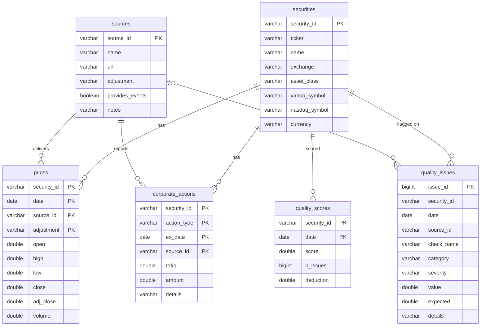

# Data model

Storage is a single DuckDB file (`data/processed/mdq.duckdb`, no ORM, plain SQL DDL in
[`mdq/store.py`](../mdq/store.py)). After each pipeline run every table is also exported to
Parquet (`data/processed/parquet/<table>.parquet`). Both directories are gitignored: vendor
data is fetched locally and never committed.

Every DataFrame is validated with a Pandera schema ([`mdq/schemas.py`](../mdq/schemas.py))
before it is inserted. Structural failures (null key, duplicate key, invalid categorical value,
uncoercible type) are quarantined and written to `quality_issues` with category `schema`.
Value-level problems such as negative prices are allowed through, so the quality checks can
score them instead of having them silently dropped.

## Why each table exists

| Table | Why |
|---|---|
| `securities` | The security master. Internal `security_id` plus each vendor's own symbol (`yahoo_symbol`, `nasdaq_symbol`), so a vendor symbology change is a one-row update instead of a data migration. Exchange and asset class drive the calendar and the per-source request type (Nasdaq needs `assetclass=etf` for ETFs). |
| `sources` | One row per vendor. Records each vendor's delivered adjustment basis and whether it provides events. Reconciliation is only meaningful between series on the same basis. |
| `prices` | One row per security × date × source × adjustment basis. `adjustment='split'` is the series as delivered (both vendors split-adjust). `adjustment='raw'` is the as-traded series reconstructed by undoing declared splits (`mdq/adjust.py`). Keeping both makes split verification a query rather than a re-download. `adj_close` holds Yahoo's split+dividend adjusted close and is used for dividend-adjustment verification. |
| `corporate_actions` | Splits (ratio = new shares per old share) and cash dividends (amount per share), keyed by ex-date. These are the expected events against which price jumps and adjustment factors are verified. Only Yahoo provides events, and `source_id` records where each event came from. |
| `quality_issues` | Append-only log of every finding from every check, including schema quarantines. It uses one shape for all checks (`value` = observed, `expected` = what the check expected, `details` = JSON evidence), so reports and the dashboard need no per-check code. |
| `quality_scores` | Score of 0–100 per security per trading day, derived from `quality_issues` with documented weights (see `docs/CHECKS.md`). Stored rather than computed on the fly so the dashboard stays fast and the scores from a run can be audited later. |
| `dataset_scores` (view) | Average of `quality_scores` per day, plus the number of affected securities. This is the dataset-level score. |

## Keys and lineage

`raw JSON (data/raw/<source>/<ticker>.json)` → parsers (`mdq/sources/*`) → Pandera → `prices`,
`corporate_actions` → checks (`mdq/checks/*`) → Pandera → `quality_issues` → scoring →
`quality_scores` → Parquet export, reports, dashboard.
