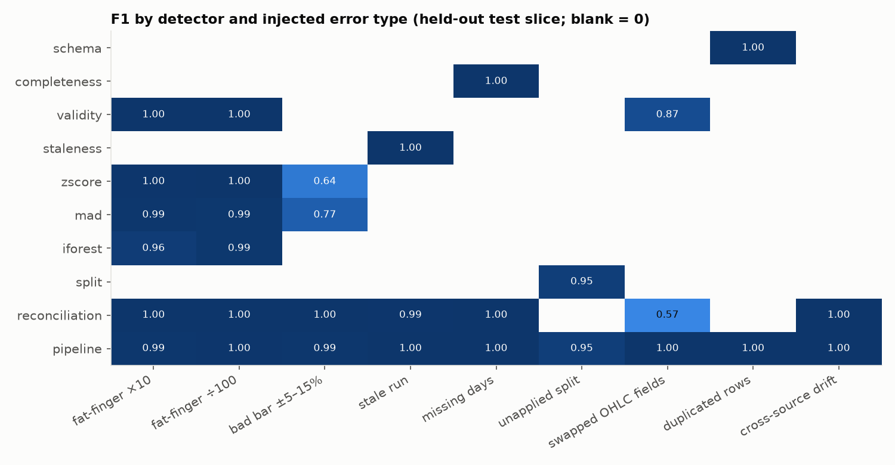
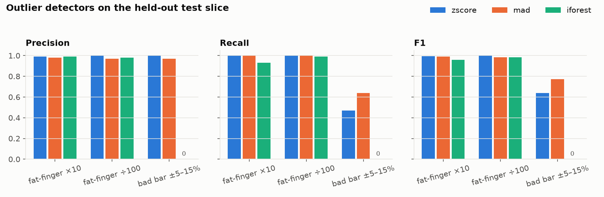
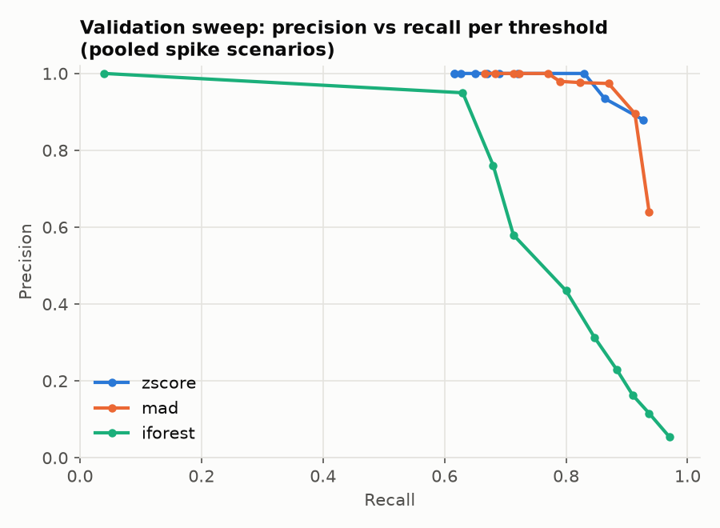

# Injected-error benchmark

Generated by `python -m mdq benchmark` (`mdq/benchmark/`). All numbers below come from
[`benchmark_results.json`](benchmark_results.json), which the same run writes.

## Setup

- **Clean slice.** Real Yahoo and Nasdaq split-adjusted daily bars, 2021-11-08 to
  2026-11-05, for the 40 securities that had **no scored issue** in
  a screening run with fixed parameters (`SCREEN_PARAMS` in `mdq/benchmark/run.py`, kept
  separate from the tuned defaults so tuning cannot change the slice it is scored on).
  Excluded (12): BA, BAC, CAT, CMCSA, CVX, JNJ, JPM, NKE, SPY, WFC, WMT, XOM. Their real issues are in
  `QUALITY_REPORT.md`. Any residual real defect in the slice counts against precision rather
  than being hidden.
- **Split by security, seed 42.** 20 validation
  securities are used for threshold tuning and 20 test securities for every
  number reported here (25,080 rows per source). No security
  appears in both halves.
- **One scenario per error type.** Each scenario injects only that error, into one randomly
  chosen source per event, at about 0.4% of rows per series (one per series for unapplied
  splits; drift windows of 20–40 sessions). Injection seeds: validation 1000+i,
  test 2000+i. Events are ≥15 sessions apart and away from series edges.
- **Matching.** A flag is a true positive when it hits an altered (security, date, source).
  Recall is measured on the *primary* labels: every altered row for most types, the ex-date
  for an unapplied split (the whole earlier history of that source is altered too, so a
  reconciliation flag there is correct, not a false positive), and drift days ≥10 bps off.
  Reconciliation and the pipeline alert set are matched on (security, date), because they are
  cross-source. Precision counts **every** flag the detector raised in the scenario, including
  alerts on genuine market moves.
- **Pipeline alerts** = all scored checks at severity ≥ warning, after cross-source
  corroboration (MAD is the only scored outlier detector). The per-detector rows are raw,
  without corroboration.
- **Error types.** fat-finger ×10 / ÷100 (close only); bad bar ±5–15% (whole bar scaled; an
  extra type, added so the outlier comparison is not trivial); stale run (bar repeated for 3–6
  sessions); missing days (1–3 consecutive rows deleted); unapplied split (history before the
  ex-date multiplied by 2–20; the event is declared in half the cases); swapped OHLC fields
  (high↔low, open↔high, close↔low or open↔close); duplicated rows (half exact, half with a
  conflicting close); cross-source drift (one source drifts linearly to 30–80 bps over 20–40
  sessions; only days ≥10 bps off are labelled).

## Results (held-out test slice)

| Error type | Labels | Designed detector | P | R | F1 | Best single detector (F1) | Pipeline alerts P / R / F1 |
|---|---|---|---|---|---|---|---|
| fat-finger ×10 | 100 | mad | 0.98 | 1.00 | 0.99 | validity (1.00) | 0.98 / 1.00 / 0.99 |
| fat-finger ÷100 | 100 | mad | 0.97 | 1.00 | 0.99 | validity (1.00) | 0.99 / 1.00 / 1.00 |
| bad bar ±5–15% | 100 | mad | 0.97 | 0.64 | 0.77 | reconciliation (1.00) | 0.98 / 1.00 / 0.99 |
| stale run | 454 | staleness | 1.00 | 1.00 | 1.00 | staleness (1.00) | 1.00 / 1.00 / 1.00 |
| missing days | 200 | completeness | 1.00 | 1.00 | 1.00 | completeness (1.00) | 1.00 / 1.00 / 1.00 |
| unapplied split | 20 | split | 1.00 | 0.90 | 0.95 | split (0.95) | 1.00 / 0.90 / 0.95 |
| swapped OHLC fields | 100 | validity | 1.00 | 0.77 | 0.87 | validity (0.87) | 1.00 / 1.00 / 1.00 |
| duplicated rows | 100 | schema | 1.00 | 1.00 | 1.00 | schema (1.00) | 1.00 / 1.00 / 1.00 |
| cross-source drift | 495 | reconciliation | 1.00 | 1.00 | 1.00 | reconciliation (1.00) | 1.00 / 1.00 / 1.00 |

### Full matrix: precision / recall / F1

"–" means the detector raised no flags in that scenario.

| detector | fat-finger ×10 | fat-finger ÷100 | bad bar ±5–15% | stale run | missing days | unapplied split | swapped OHLC fields | duplicated rows | cross-source drift |
|---|---|---|---|---|---|---|---|---|---|
| schema | – (0 flags) | – (0 flags) | – (0 flags) | – (0 flags) | – (0 flags) | – (0 flags) | – (0 flags) | 1.00 / 1.00 / 1.00 | – (0 flags) |
| completeness | – (0 flags) | – (0 flags) | – (0 flags) | – (0 flags) | 1.00 / 1.00 / 1.00 | – (0 flags) | – (0 flags) | – (0 flags) | – (0 flags) |
| validity | 1.00 / 1.00 / 1.00 | 1.00 / 1.00 / 1.00 | – (0 flags) | – (0 flags) | – (0 flags) | – (0 flags) | 1.00 / 0.77 / 0.87 | – (0 flags) | – (0 flags) |
| staleness | – (0 flags) | – (0 flags) | – (0 flags) | 1.00 / 1.00 / 1.00 | – (0 flags) | – (0 flags) | – (0 flags) | – (0 flags) | – (0 flags) |
| zscore | 0.99 / 1.00 / 1.00 | 1.00 / 1.00 / 1.00 | 1.00 / 0.47 / 0.64 | – (0 flags) | – (0 flags) | 1.00 / 0.00 / 0.00 | – (0 flags) | – (0 flags) | – (0 flags) |
| mad | 0.98 / 1.00 / 0.99 | 0.97 / 1.00 / 0.99 | 0.97 / 0.64 / 0.77 | 0.00 / 0.00 / 0.00 | 0.00 / 0.00 / 0.00 | 0.33 / 0.00 / 0.00 | 0.00 / 0.00 / 0.00 | 0.00 / 0.00 / 0.00 | 0.00 / 0.00 / 0.00 |
| iforest | 0.99 / 0.93 / 0.96 | 0.98 / 0.99 / 0.99 | 0.00 / 0.00 / 0.00 | 0.00 / 0.00 / 0.00 | 0.00 / 0.00 / 0.00 | 0.12 / 0.00 / 0.00 | 0.00 / 0.00 / 0.00 | 0.00 / 0.00 / 0.00 | 0.00 / 0.00 / 0.00 |
| split | – (0 flags) | – (0 flags) | – (0 flags) | – (0 flags) | – (0 flags) | 1.00 / 0.90 / 0.95 | – (0 flags) | – (0 flags) | – (0 flags) |
| reconciliation | 1.00 / 1.00 / 1.00 | 1.00 / 1.00 / 1.00 | 1.00 / 1.00 / 1.00 | 1.00 / 0.99 / 0.99 | 1.00 / 1.00 / 1.00 | 1.00 / 0.00 / 0.00 | 1.00 / 0.40 / 0.57 | – (0 flags) | 1.00 / 1.00 / 1.00 |
| pipeline | 0.98 / 1.00 / 0.99 | 0.99 / 1.00 / 1.00 | 0.98 / 1.00 / 0.99 | 1.00 / 1.00 / 1.00 | 1.00 / 1.00 / 1.00 | 1.00 / 0.90 / 0.95 | 1.00 / 1.00 / 1.00 | 1.00 / 1.00 / 1.00 | 1.00 / 1.00 / 1.00 |

## Outlier detectors: z-score vs MAD vs Isolation Forest

| Error type | Detector | Precision | Recall | F1 | Flags | Detected / labels |
|---|---|---|---|---|---|---|
| fat-finger ×10 | zscore | 0.99 | 1.00 | 1.00 | 101 | 100 / 100 |
| fat-finger ×10 | mad | 0.98 | 1.00 | 0.99 | 102 | 100 / 100 |
| fat-finger ×10 | iforest | 0.99 | 0.93 | 0.96 | 94 | 93 / 100 |
| fat-finger ÷100 | zscore | 1.00 | 1.00 | 1.00 | 100 | 100 / 100 |
| fat-finger ÷100 | mad | 0.97 | 1.00 | 0.99 | 103 | 100 / 100 |
| fat-finger ÷100 | iforest | 0.98 | 0.99 | 0.99 | 101 | 99 / 100 |
| bad bar ±5–15% | zscore | 1.00 | 0.47 | 0.64 | 47 | 47 / 100 |
| bad bar ±5–15% | mad | 0.97 | 0.64 | 0.77 | 66 | 64 / 100 |
| bad bar ±5–15% | iforest | 0.00 | 0.00 | 0.00 | 8 | 0 / 100 |

## Threshold tuning (validation slice only)

The best F1 on the validation scenarios wins. Ties go to the more sensitive value. The chosen
values are the defaults in `mdq/config.py`.

| Parameter | Grid | Tuned on (validation) | Chosen | Validation P / R / F1 |
|---|---|---|---|---|
| `zscore_threshold` | 3, 4, 5, 6, 7, 8, 10, 12, 15, 20 | spike ×10, ÷100, bad bar | 5.0 | 1.00 / 0.83 / 0.91 |
| `mad_threshold` | 3, 4, 5, 6, 7, 8, 10, 12, 15, 20 | spike ×10, ÷100, bad bar | 5.0 | 0.97 / 0.87 / 0.92 |
| `iforest_threshold` | 0.55, 0.6, 0.62, 0.64, 0.66, 0.68, 0.7, 0.72, 0.75, 0.8 | spike ×10, ÷100, bad bar | 0.75 | 0.95 / 0.63 / 0.76 |
| `stale_min_run` | 2, 3, 4, 5 | stale run | 4.0 | 1.00 / 1.00 / 1.00 |
| `recon_tolerance_bps` | 2, 5, 10, 15, 20, 30, 50 | drift, bad bar | 2.0 | 1.00 / 1.00 / 1.00 |
| `split_log_tolerance` | 0.02, 0.05, 0.1, 0.15, 0.2 | unapplied split | 0.1 | 1.00 / 1.00 / 1.00 |

## Blame attribution (reconciliation, test slice)

On injected days the reconciliation check flagged, how often it named the source that was
actually corrupted:

| Error type | Recon flags on injected days | Correct source | Undetermined | Wrong source | Correct % |
|---|---|---|---|---|---|
| fat-finger ×10 | 100 | 100 | 0 | 0 | 100.0 |
| fat-finger ÷100 | 100 | 100 | 0 | 0 | 100.0 |
| bad bar ±5–15% | 100 | 95 | 5 | 0 | 95.0 |
| stale run | 448 | 18 | 341 | 89 | 4.0 |
| swapped OHLC fields | 40 | 14 | 25 | 1 | 35.0 |
| cross-source drift | 495 | 12 | 470 | 13 | 2.4 |

## Notes and limitations

- The dividend-adjustment check is not benchmarked, because no dividend error type is
  injected. `adj_close` is blanked in the slice so that it doesn't trivially expose close
  edits.
- Real market moves in the clean slice are genuine negatives. Every outlier flag on an
  un-injected day counts as a false positive, even when it is a real large move that partly
  reversed the next day.
- Unapplied splits: the 2 test misses both coincide with large real moves. On one ex-date the
  real return was about −20%, so the implied ratio was 0.16 instead of 0.20 and fell outside
  the log tolerance. In the other, a rally of about +30% within the 5-session persistence
  window broke the level-shift test.
- Blame works for point errors (spikes, bad bars) and is unreliable for stale runs and
  drift. Both of those produce smooth, internally consistent series, and with two sources
  there is no majority vote. Read stale-run and drift blame as "undetermined", whatever the
  per-day output.
- Selection effect: the slice was screened at 10 bps, and the reconciliation tolerance was
  then tuned down to 2 bps on it. On the full real dataset the 2 bps setting produced the
  same mismatch count as 10 bps (see `QUALITY_REPORT.md`), so the effect is small here, but
  it would need re-checking on another universe.
- The labels define drift as ≥10 bps. Drift below that is invisible by design.
- The mixed case (several error types in the same week) is not measured. Each scenario is
  isolated so that per-type precision is well defined.
- Runtime: 337.8 s.
